# MapReduce

> A complete guide to Hadoop's processing engine — architecture, flow, formats, and internals.

---

## MapReduce Agenda

- MapReduce Introduction
- MapReduce Daemons and Its Architecture
- MapReduce Program Flow
- MapReduce Input and Output Formats
- MapReduce Data Types
- MapReduce Code Walkthrough
- MapReduce YARN Architecture
- MapReduce Project Setup in IDE
- MapReduce JAR File Creation
- Input Splits
- Speculative Execution
- MapReduce Conclusion

---

## Table of Contents

1. [MapReduce Introduction](#1-mapreduce-introduction)
2. [Technical Terms to Know About MapReduce](#2-technical-terms-to-know-about-mapreduce)
3. [Important Questions and Answers](#3-important-questions-and-answers)
4. [Hadoop Old Version (V1) Job Architecture](#4-hadoop-old-version-v1-job-architecture)
5. [MapReduce Program Flow](#5-mapreduce-program-flow)
6. [MapReduce Input and Output Formats](#6-mapreduce-input-and-output-formats)
7. [MapReduce Input and Output Diagram](#7-mapreduce-input-and-output-diagram)
8. [DataTypes in MapReduce](#8-datatypes-in-mapreduce)
9. [MapReduce Project Setup in IDE](#9-mapreduce-project-setup-in-ide)
10. [MapReduce Code Walkthrough](#10-mapreduce-code-walkthrough)
11. [MapReduce JAR File Creation](#11-mapreduce-jar-file-creation)
12. [MapReduce YARN Architecture](#12-mapreduce-yarn-architecture)
13. [Input Splits](#13-input-splits)
14. [Speculative Execution](#14-speculative-execution)
15. [MapReduce Conclusion](#15-mapreduce-conclusion)

---

## 1. MapReduce Introduction

MapReduce (MR) is one of the **core components** in Hadoop. We can call it the **engine of Hadoop**.

Hadoop has 2 major components:

| Component | Purpose |
|-----------|---------|
| **HDFS** | Stores data in a distributed way |
| **MapReduce** | Processes the distributed data in parallel |

### History

- HDFS was derived from **Google File System (GFS)** — a research paper Google invented.
- Google released a research paper called **GMR (Google MapReduce)** in 2006.
- From that paper, **MapReduce (MR)** was invented.

---

## 2. Technical Terms to Know About MapReduce

**MR = MapReduce**

### 2.1 What is MR called?

It is a **processing framework**, or we can say MapReduce is an **engine in Hadoop**.

Many people call MapReduce a "MapReduce algorithm." It is actually a **framework built from an algorithm**. Instead of calling it an algorithm, we can call it **batch processing**.

Generally, there are 2 types of processing:

| Type | Description | Example |
|------|-------------|---------|
| **Batch Processing** | Data comes from the frontend. You receive data in an application or on an Amazon website, store it in a DB or file, and after storing, you process the full data. | At the end of the month, you check your bank statement to see last month's transactions. |
| **Stream Processing** | Real-time data. As soon as a transaction happens, they capture it and process it immediately. | When you go to a departmental store and swipe your card or use GPay, the amount gets debited as you swipe. |

> **Important:**
> - MapReduce **only does batch processing**. It does **not** do stream processing.
> - MapReduce only reads data that has **already fallen into it**. It does not take data that is already in stream.
> - If you write and deploy code for batch processing, the program will **finish as soon as the input is finished**.
> - For stream processing, the code will run for **24 hours** because you don't know when real-time transactions will come (e.g., Spark Streaming).

### 2.2 What language do we use in MR?

The programming language used is **Java** by default.

MapReduce supports **C, C++, Java, Python** — about 6 to 7 languages. But we still go for **Java** because it gives **better performance** compared to other languages.

> **Note:**
> - Many frameworks support a minimum of 3 languages.
> - **Spark** supports Python, Scala, and Java. Spark gives you better performance in any language.
> - But **MapReduce is not like that**. You have to write it in **Java**.

### 2.3 Advantages / Why MR?

This question is not just for MR. For any framework, the advantages are the same. **MR processes in parallel.**

When we write in a framework, we only need to focus on our **logic/query**. The framework takes care of:

| Feature | Description |
|---------|-------------|
| **Cluster Monitoring** | If a node fails, your code will not be killed, your data will not be lost, and processing will continue. |
| **Resource Allocation** | How much RAM is needed, how many threads are needed for these jobs — the framework takes care of all this. |
| **Cluster Management** | If a node fails, the job will restart on another node. |
| **Scheduling** | Which job should run first, which job next — the framework handles this. |
| **Execution** | Executing your code properly and giving results. |
| **Speculative Execution** | A type of execution (explained in upcoming concepts). |

> **Why go for a framework?**
> Even though I know programming and logic, the reason we go for a framework is because it provides all of the above. Spark also has all of this, plus many additional features.

### 2.4 Aim of MR?

To achieve **data locality**.

> **Example:**
> You have 1 GB of data already placed in HDFS, split across 10 nodes. Now you write a program in MR for this 1 GB. Your program will find all the data pieces across the 10 different nodes and **run the process on those nodes**.

### 2.5 Main use of MR?

**Parallelism**.

We split our job into tasks and process each task in parallel.

### 2.6 Abstraction of MR?

**Hive, Pig, Sqoop, Oozie**

In MR, you have to write Java. But if you say "I don't like writing Java for MR," then you can use any of these 4:

| Tool | Purpose | Invented By |
|------|---------|-------------|
| **Hive** | Uses SQL | Facebook |
| **Pig** | Uses Pig Latin script | Yahoo |
| **Sqoop** | Takes data from RDBMS databases and brings it into Hadoop | — |
| **Oozie** | A scheduler | — |

> **Key Point:**
> All 4 of these **run on the MR daemon and engine**. Without MR, none of these 4 can run.

**Detailed Explanation:**

- **Hive** → Facebook invented Hive because they liked MR a lot but didn't like writing in Java. In Java, 20 lines of code would be 2 or 3 lines in SQL. Hive is like a **language mediator** — you speak SQL, but Hive converts it to Java and talks to MR.

- **Pig** → Yahoo invented Pig for the same reason. They knew Pig Latin script and wanted to use it in MR.

- **Sqoop** → Used to move data from RDBMS to Hadoop using Sqoop commands. Before Sqoop, we wrote full MapReduce code to connect to MySQL database, get data, put it in HDFS, and process it.

- **Oozie** → A scheduler. You can schedule Hive jobs, Pig jobs, HDFS jobs, MR jobs. For example, you want to run an MR job, then after its output, run a Hive job, and after that finishes, put it in HDFS — once every hour.

> **Very Important Point:**
> Hive, Pig, Sqoop, Oozie are **NOT alternatives to MR**. Many people make this mistake. They are not alternatives. The alternative is for the **Java in MR**. The alternative to MR is **Spark**.

### 2.7 Alternative of MR?

**Spark**

### 2.8 Daemons in MR?

| Hadoop Version | Daemons |
|----------------|---------|
| **Hadoop V1** | JobTracker and TaskTracker |
| **Hadoop V2 & V3** | ResourceManager and NodeManager |

### 2.9 Map and Reduce — The Core Concept

| Component | Purpose |
|-----------|---------|
| **Map** | Parallelism |
| **Reduce** | Grouping |

If we want to use MR, data must be **distributed and stored**. That is what we do in **HDFS**.

### 2.10 Traditional Example: School Teacher Correcting Papers

<div align="center">
  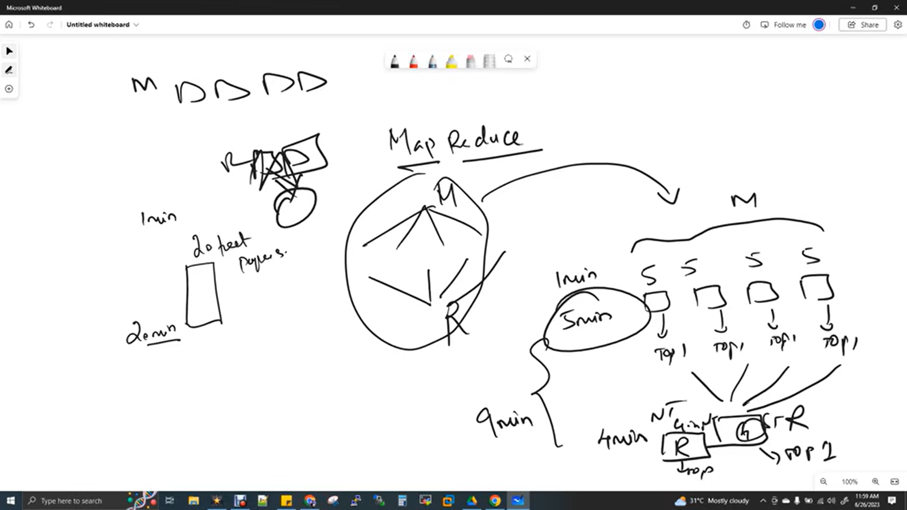
</div>

**Scenario:** Exams are over, and 20 test papers need to be corrected. One test paper takes 1 minute to correct.

| Approach | Time Taken |
|----------|------------|
| **Single Resource** | 20 papers × 1 minute = **20 minutes** |
| **Distributed (4 machines, 5 papers each)** | 5 minutes (parallel processing) |

**How it works:**

1. **HDFS** splits these 20 papers across **4 machines** — 5 papers each.
2. **4 resources (teachers)** start correcting in parallel.
3. Each teacher takes 1 minute per paper. In 5 minutes, all 4 resources finish.
4. **Complete parallel processing finishes in 5 minutes.**

**Now, think about the 10th public exam results:**

- They correct papers **district-wise**.
- They announce the **district first**.
- Then they send all district firsts to the **state capital** and consolidate to decide the **state first**.

**MapReduce Equivalent:**

| Step | Description |
|------|-------------|
| **Map Phase** | 4 resources pick the top 1 from their 5 papers (district firsts announced in parallel). |
| **Reduce Phase** | These 4 outputs go to another resource. That resource gets 4 inputs and picks one topper from those 4 inputs (state first). |

> **Time Calculation:**
> - 4 minutes for parallel staff correction + 5 minutes = **9 minutes total**
> - Instead of 20 minutes, we finished in 9 minutes.
> - That's about **60% performance increase**.

**What if we need 2 results (2 state firsts)?**

- Split the state into **South Tamil Nadu** and **North Tamil Nadu** — each gets a state first.
- 4 resources correct their papers, and then there are **2 reducers**.
- One picks the top 1 from North Tamil Nadu, and the other picks the top 1 from South Tamil Nadu.

> **Key Insight:**
> However many output partitions you need, that's how many **reducers** you increase in the code.

---

## 3. Important Questions and Answers

<div align="center">
  
</div>


### 3.1 Who decides the map count?

**Two Options:**

1. **Number of blocks = Number of mappers**
2. **Number of nodes = Number of mappers**

**Correct Answer: Option 1 — Number of blocks = Number of mappers**

**Why Option 2 is not correct:**

> **Example:**
> Suppose I have 4 blocks (B0, B1, B2, B3). Let's name them **Karur, Erode, Coimbatore, and Trichy**.
>
> - Suddenly, there is an issue in **Erode** — a strike happens, and the teachers there cannot correct papers.
> - So I cannot announce the district first. But the state first cannot be announced until Erode district finishes.
> - **If one mapper does not give output, the entire job's output cannot be given.**
> - Because the reducer will start only when **all mappers complete**. That is the rule.
>
> **Just like election results** — the final result must wait for all mappers to give output.

**What happens in this situation?**

- The staff here cannot be changed. They tell the block next to B1 to move to Karur district.
- The B1 paper parcel comes to Karur.
- Here, resources are already booked. They are correcting B0. They cannot be told to correct again.
- In Erode, resources are already hired, but they cannot work due to the strike.
- **So what do I do?** I hire resources again in Karur to correct B1.

**Result:**

| District | Mappers |
|----------|---------|
| Karur | M1, M2 |
| Coimbatore | M3 |
| Trichy | M4 |

- **Number of nodes = 3**, but **there are 4 mappers**.
- So "number of nodes = number of mappers" is **not correct**.

> **Final Answer: Number of blocks = Number of mappers**
> - B1 and B2 can be on the same node.
> - It is guaranteed that 2 blocks can be on the same node.
> - So 2 mappers are created there.

**Important Note:**

"Number of blocks = Number of mappers" is **not always equal**.

- In the mapper, we can do a setting.
- One block B1 can trigger **2 mappers** M1, M2 for faster job processing.
- For example, if you have a lot of RAM, instead of one mapper per block, you can put 2 mappers per block.
- **But still, it is block-based. Mappers are not node-based.**

**Interview Answer:**

> **Q:** "What is the number of mappers based on?"
>
> **A:** "Default Number of blocks" — and this is changeable.
> - MapReduce has a property through which we can say that one block can run 2 mappers.
> - Similarly, we can reduce it.
> - If there are 2 blocks B0, B1, first rule: 2 blocks means 2 mappers.
> - Or both can be done with one mapper M1.
> - If there is no RAM, you can run it with the available RAM.
> - If you give more RAM, you can run 2 mappers for one block.
> - So 2 blocks can have 4 mappers: B0 → M1, M2 and B1 → M3, M4.

---

## 4. Hadoop Old Version (V1) Job Architecture

### (JobTracker and TaskTracker)

<div align="center">
  
</div>

In MapReduce, we write Java code. After writing, what do we do?

**We convert it to a JAR.** JAR = Java Archive.

After archiving, we send the code to production and run it. So MapReduce shows all this. In MapReduce, a developer must **convert their code to a JAR and submit it to the cluster**.

### 4.1 The JobTracker — The King

When submitting the job, the request goes to the MapReduce daemon (**JobTracker and TaskTracker**).

> **The JobTracker is like the king.**
> - Just as **NameNode** is the leader in Hadoop, for MapReduce, the **JobTracker** is like that.
> - **NameNode is the king, JobTracker is the queen.**
> - Together they are called the **master**.
> - These two are not separate masters — **together they are one master**.

### 4.2 How Job Submission Works

**Step 1:** The request goes to the **JobTracker**.

**Step 2:** The JobTracker receives the request and does:
- Cluster management
- Resources
- Resource allocation
- Scheduling
- Speculative execution

**Step 3:** But for the JobTracker to do all this, it needs to know **where your input file is**.

- You are sending a request to run a MapReduce JAR on an input.
- The JAR file is ready, and it needs to run on the input.
- So the JobTracker needs to know **where the input is**.

**Step 4:** For that, the JobTracker **connects to the NameNode**.

- Why? Because the NameNode has all the **metadata information** about your input file.
- That is, for this particular input request, how many blocks it is split into, which blocks are where, how many replications there are — all this information is in the NameNode's metadata.

**Step 5:** The JobTracker asks the NameNode for the **block details** of the job.

> **Example:**
> - You are sending a JAR file and a `data10.txt` file as input.
> - You are running your JAR on this input.
> - So the JobTracker asks the NameNode to send the block details of `data10.txt`.
> - The NameNode has split this file into **3 blocks**: b0, b1, b2.
> - Each block is replicated **3 times**.
> - It sends all the details of which nodes (machine addresses) the replicas are on to the JobTracker.

### 4.3 Slave Nodes — DataNode and TaskTracker

Now we have slave nodes. Let's say we have **4 slave nodes**.

| Component | Belongs To |
|-----------|------------|
| **TaskTrackers** | JobTracker's slaves |
| **DataNodes** | NameNode's slaves |

> **Note:** A slave node is a **combination of DataNode and TaskTracker**.

**What does the NameNode say?**

> "For `data10.txt`, there are 3 blocks. There is also replication, but for now, we don't need replication."

**Why replication?**

- MapReduce will process **only one copy**.
- You have multiple copies. Why? If one node goes down, the other copy is on another node, and we can take it from there.
- So Hadoop will not say "a node failed and the data is gone."
- That is **fault tolerance** in HDFS.

**In MapReduce, only one copy is processed.**

> **Why?** Doing the same processing again and again on the same input is a waste. So MapReduce will do one. If it is not available, it will take the 2nd copy.

**Example:**

| Block | Node |
|-------|------|
| b0 | 1st node |
| b1 | 3rd node |
| b2 | 2nd node |

The DataNode controls which block is where.

### 4.4 Task Execution

Once the JobTracker gets all this information, it connects to the **TaskTrackers** on those slave nodes **in parallel**.

**What happens next?**

1. The JobTracker connects to the TaskTrackers on the 3 machines and tells them to run the JAR file.
2. The JAR file contains your **map code + reducer code**.
3. The JobTracker tells them to run **only the map code first**.
4. It gives instructions to the 3 TaskTrackers to start the process **in parallel**.

**Just like the professor corrects papers at the same time.**

Similarly, the TaskTracker creates a task for each map request. It creates a **JVM (Java Virtual Machine)**.

- This will go to all three blocks (b0, b1, b2) in the node and process them.
- While processing, it sends **heartbeats** (information like "I am alive," "the task is running or not") to the JobTracker **every 3 seconds**.
- Through this, the JobTracker knows whether the job is finished or failed.

### 4.5 Failure Handling

**Suppose the 2nd node fails. What happens to the task that was running?**

> You said if one mapper does not run, it will not give a result. So what happens?

**Scenario:** b2 on the 2nd node fails.

1. The JobTracker checks where the **replica of b2** is.
2. The replica is on the **3rd node**.
3. So the JobTracker assigns a task again to the 3rd node and tells it to run b2 there.
4. It creates another task here.

> **Result:** Even if a task fails because the machine is not available or data is not available, **the whole job does not fail**. The task is reassigned to the 2nd replica.

**How does the TaskTracker read data?**

- The TaskTracker launches the task.
- It processes b0, b2, b1.
- The TaskTracker connects to the **DataNode** and reads and processes the data.
- This is called **lookup**.

### 4.6 Map Output and Reducer

**Suppose 3 mappers finish.**

Now we call this the **Map Output**.

> **Where is the mapper's output stored immediately after the map finishes?**
>
> **Answer:** It is stored **temporarily in the local file system** of that node.

**What happens next?**

1. All mappers tell the TaskTracker, "We have finished."
2. Then the JobTracker starts the **reducer** on the next node.
3. **Does the reducer start on a free node, or does it start on the node where the map finished?**
   - That is up to the JobTracker.
   - It may start the reducer on the node where the map finished, or it may assign the reducer task to a new free node and start the TaskTracker there.
4. The JobTracker tells the 3 mapper machines: "You have kept your output locally. Send it to the reducer."
5. So the output from all machines goes to the reducer.
6. The protocol used for this is **HTTP (HyperText Transfer Protocol)**.
   - This is a general network protocol.
   - Through this, the mapper's output goes to the reducer.
7. As soon as the reducer gets the input, it starts processing.

> **Important:**
> - The reducer's input comes from the **mapper's output**.
> - But the mapper's input comes from **blocks**.
> - This is very important.

**Final Output:**

- Once the reducer finishes its process, it stores its output in **HDFS**.
- So both input and output are stored in HDFS.
- Or you can store it in a particular file system, database, or NoSQL.
- **By default, MapReduce reads from HDFS and writes to HDFS.**

### 4.7 JVM Configuration

**How does the TaskTracker behave by default?**

- The TaskTracker gets a task assigned by the JobTracker.
- The JobTracker assigns only **one map task**.
- So the TaskTracker launches **two JVM** for that one map task.

**But wait — why launch 2 JVMs?**

> This is the **default configuration**. The mapper's child process launches **2 JVMs** whenever a task comes.
> - For example, if there is only one map task, one JVM is used, and the other is not used.
> - So by default, it launches **2**.

**Example:**

| Scenario | JVMs Launched |
|----------|---------------|
| TaskTracker has 2 blocks (b0, b1) | 2 JVMs — one for b0, one for b1 |
| TaskTracker has 1 block | 1 JVM |
| TaskTracker has 3 blocks (b0, b1, b2) | 2 JVMs — b0 and b1 run, b2 waits in queue |

> **Key Point:**
> - b0 does **not** wait for b1 to finish.
> - The TaskTracker starts both.
> - By default, **2 JVMs**.
> - It does not look at whether there are 4, 3, 2, or 1 blocks. It launches **2 JVM tasks**.
> - If there are 3 blocks, one task runs for b0, another for b1, and b2 waits in the queue.
> - When one of the two finishes, b2 goes next.

**Can I increase parallelism?**

> **Yes, definitely.**
> - If you want to increase parallelism, you can do it.
> - That is this particular property: **The map child task default is 2**.
> - You can increase it to 3, 4.
> - But as a developer, I don't know how many blocks are split on that particular TaskTracker node.
> - So until it finishes, you can increase parallelism.
> - It depends on the company.
> - This property is set in **`mapred-site.xml`**.
> - Each company has different configurations. They set a default number in the configuration.

**What if I set it to 3?**

- If you remove it and put 3, then whenever a task request comes from the JobTracker to a TaskTracker, it will release **3**.
- Whether there are 3 blocks or 1 or 2 blocks, it will launch **3 JVMs**.
- But if there is 1, it will use only that one and keep the other 2 **idle**.
- That means it won't use them.
- You might ask: "If 3, then launching 3 at a time is a waste of resources."
- But it's not like that. It will use them if needed, or leave them.
- If the blocks exceed the task limit, the extra blocks **wait in the queue**.

### 4.8 V1 Limitation

**In V1, if the JobTracker fails, nothing can be done.**

- Running MapReduce jobs, Hive jobs, Pig jobs, Sqoop jobs — I mention Hive and Pig because they all run on top of JobTracker and MapReduce.
- **So all jobs will fail.**
- But in **Version 2**, they brought a solution. We will see that architecture too.

---

## 5. MapReduce Program Flow

In MapReduce, data transfer from the map node to the reducer node happens via **HTTP protocol**.

**Consider MapReduce:**

| Component | Input | Output |
|-----------|-------|--------|
| **Mapper** | Input(I/P) | Output(O/P) |
| **Reducer** | Input(I/P) | Output(O/P) |

**Flow:**

1. The mapper's input is **blocks**.
2. Then the map processes and gives output.
3. This mapper's output (O/P) goes as reducer input (I/P).
4. Then the reducer's ouput (0/P → HDFS) processes and stores its output in HDFS.

### 5.1 Key-Value Pair Format

**How does all this happen?**

> **The input and output must be in key-value pair format.**

That is:
- The mapper's input must be in key-value pair
- The output must be in key-value pair
- The reducer's input must be in key-value pair
- The output must be in key-value pair

**What is a key-value pair?**

> **Example:**
> Suppose we have data: `1, gowtham, male, 100, avil`
> - This data goes as input to MapReduce.
> - This is a file.
> - We need to send this data as key-value pairs.
> - We split the data into key-value pairs.

**Who splits the data?**

- Do we split the dataset into key-value pairs ourselves, or does MapReduce do it?
- **MapReduce will do it.**
- We can also do it.
- For that, we call it **Input and Output Formats**.

**Types of Formats:**

| Type | Description |
|------|-------------|
| **Default I/O Format** | MapReduce provides some input and output formats by default. Through that, MapReduce will split into key-value pairs. |
| **Custom Input and Output Format** | If I split my data into key-value pairs myself and then send it to MapReduce. |

> **Note:** In most cases, the **default I/O format** given by MapReduce is enough. That itself will split into key-value pairs.

---

## 6. MapReduce Input and Output Formats

MapReduce gives **5 types** of key-value formats. I will explain some. You don't need to know all.

> **Note:** In Spark, Hive, etc., they call these **storage formats**. But in MapReduce, we call them **key-value pairs** or **I/O formats**.

Among them, the most repeatedly used format:

### 6.1 Text Input and Text Output Format

**Example:** Data comes as `1, gowtham, male, 100`.

**If we use this format, which is key and which is value?**

> **In interviews, they ask:** "This is the dataset. If you use this format, what is key-value?"

**Answer:**

| Part | Description |
|------|-------------|
| **Key** | The **offset of the record** |
| **Value** | The **whole line of the record** |

> **"Whole line is value"** means `1, gowtham, male, 100` is the value.

**What is offset?**

- The offset is the **position of the data**.
- For example, 1→0, comma→1, g→2, o→3, w→4, and so on.
- Like when you put data in Notepad, the letter count comes. The first one is **0**.
- That is the offset.

**Example:**

| Record | Key (Offset) | Value |
|--------|--------------|-------|
| `1, gowtham, male, 100` | 0 | `1, gowtham, male, 100` |
| `2, kumar, male, 100` | 37 | `2, kumar, male, 100` |

**How is the offset calculated?**

- For the first dataset `1, gowtham, male, 100`:
  - 1→0, comma→1, g→2, o→3, w→4, and so on until 100 finishes.
  - The last zero is 0→36.
- The next dataset `2, kumar, male, 100` will start at **37**.
  - So 37 is the key for the 2nd record.
  - `2, kumar, male, 100` is the full value.

**How do we know that after 36, the next is 37?**

- Because `1, gowtham, male, 100\n` (newline is the delimiter).
- After each newline, the record's offset value is taken.
- This format **does not know** that this is the 2nd record and that `2, kumar` should be split.
- Here, it looks for the **newline character**.
- After that, whatever is there is taken as the next line record.

> **Important:**
> - If you give the dataset correctly, it will take it correctly.
> - If you give it wrong, it will take it wrong.
> - We cannot blame the key-value format for that.
> - We must give our data correctly. We must put the newline correctly after each record.

**Advantage of this format:**

- Our **whole record becomes the value**.
- We can do whatever we want with it.
- The key is **not related to the data** in our record, like 1 or Gowtham.
- The key is not related to the record at all.
- That is why many people use this format a lot.

### 6.2 Key-Value Input and Output Format

**If you use this format:**

- Up to the **1st `<tab>` delimiter** is the key.
- By default, **`<tab>` → key**, and the remaining lines of the record are the **value**.

**Delimiters are:** comma, semicolon, tab, pipe, newline, colon, space, hyphen, slash.

**Example:**

`1<tab>gowtham, male, 100`

| Part | Value |
|------|-------|
| **Key** | 1 |
| **Value** | `gowtham, male, 100` |

- Here, the key-value goes from **your record**.
- This has different use cases.
- The default delimiter is **tab**, but we can change it to **comma**.

**Example with comma:**

`1, gowtham, male, 100`

| Part | Value |
|------|-------|
| **Key** | 1 |
| **Value** | `gowtham, male, 100` |

### 6.3 Other Formats

They also give MapReduce formats for **NoSQL databases**.

- They give formats to read from **HBase, Cassandra**.
- For example, Cassandra gives an input format for MapReduce.
- Similarly, for connecting to RDBMS databases, there is a **DB input format** available open source.
- You don't need to write that code.
- You can take it and connect to Oracle, MySQL, and read.
- But for all that, **Sqoop** came.

> **Note:** So whichever technology you connect MapReduce to, you need to give that input format, or you write it yourself.

**I will show you a MapReduce program. In that, I will show you using the Text Input and Text Output format. That is why I am explaining this.**

Next, we will see a diagram. In that, we will see in detail how data comes into the map, goes to the reducer, the map output becomes the reducer input, and how it is written to HDFS, using our logic.

---

## 7. MapReduce Input and Output Diagram

<div align="center">
  
</div>

Look at this diagram. It shows how the MapReduce code works.

I designed this diagram according to the input dataset we give. Before this diagram, I already told you about map and reducer. Map has an input and output. Similarly, reducer has an input and output. **All these inputs and outputs are in key-value pair format.** We saw some key-value pairs.

### 7.1 The Scenario

**Here, the input has 7 records.** These 7 records are split into **b0, b1** in HDFS. Let's say **64 MB per block**. So it is split into two blocks.

**Imagine I have an electrical shop.**

- I have mobile, TV, AC, laptop, washing machine, etc.
- I sell my products on **Amazon, Flipkart, and eBay**.
- Today, I want to create a report of how much was sold on Amazon, Flipkart, and eBay.
- As a shop owner, I want details of how much each e-commerce platform sold.

**Query:**

- platform → e-commerce (Amazon, Flipkart, eBay)
- sales → table name


**Output:**

| Platform | Sales |
|----------|-------|
| Amazon | 8500 |
| eBay | 7800 |
| Flipkart | 17000 |

> **Note:**
> - This can be easily written in a **one-line query** if we have **Hive**, which supports queries in Hadoop.
> - Instead of writing Java in MapReduce, we write SQL in Hive.
> - Hive internally converts it to MapReduce (Java) and runs it.
> - That is, **same performance, different language**.
> - So if we do this in Hive, one line finishes it. No need for MapReduce.

**Imagine if there is no Hive. How would we find this in MapReduce? Let's see only that.**

> **Note:** I already said you need to know the MapReduce architecture, fundamentals, and functionality. But today, we don't write MapReduce code or use MapReduce components internally. We have all moved to **Spark**. HDFS, then Spark. We use Hive, Pig, Sqoop, Oozie today, but we don't use MapReduce. But still, you need to know its architecture.

### 7.2 The Diagram Explained

Now look at the diagram.

**In b0, there is a box called map. This is the mapper.**

- This map has an input `k1` and `v1`, and output `k2` and `v2`.
- Similarly, the reducer has input `k3` and `v3`, and output `k4` and `v4`.

**Since there are 2 blocks, 2 mappers are created.**

> **So we know: Number of blocks = Number of mappers**

| Block | Mapper | Input | Output |
|-------|--------|-------|--------|
| b0 | Mapper 1 | k1, v1 | k2, v2 |
| b1 | Mapper 2 | k1, v1 | k2, v2 |

**Reducer:**

- `k3` and `v3` → reducer input
- `k4` and `v4` → reducer's final output (the final output of the reducer combining two blocks)

**The mapper's input must be in key-value format.**

- Here, the **Text Input and Text Output format** is used.
- So the **offset of the record is the key**, and the **whole line is the value**.
- That is how it is in the diagram.

### 7.3 Writing the Logic

Now let's see what logic to write in the map and what logic to write in the reducer.

**Our requirement is this query. We need to achieve it in MapReduce.**

> Imagine there is no Hive. You are submitting a JAR file. The MapReduce code JAR file has one class for map and one class for reducer. The map has the map logic, and the reducer has the reducer logic.

> **Key Point:**
> - **Map is for parallelism**
> - **Reducer is for final grouping**

So we need to split this query into two sets of logic — one in map and another in reducer.

**Let's see how to write it.**

In the query, **platform and amount** are filtered, and **sum** is the aggregation. So leave that. From the input, there are 4 columns, but only 2 columns are taken from the table.

| Query Part | Where to Write |
|------------|----------------|
| **SELECT** | **Map** (because this is parallelism — it selects everything and gives it to the final reducer, where it gets grouped) |
| **GROUP BY** | **Reducer** |

> **So this is how you need to know what to write in map and what to write in reducer.**

**In map, we write only the select.**

- From the 4 columns, only 2 are taken in the map's output (`k2, v2` for both blocks/maps).
- It reads 4 columns and outputs only 2.

> **Question:** "When data comes into the map, the input key is the offset. Now when it comes out of the map, how does the key change to something from our data, like platform?"
>
> **Answer:** The input and output formats given by MapReduce are only for bringing data in. After that, whatever logic is needed, we split into key-value pairs accordingly. It is just **one line of code**.
>
> So the map's output key type must be **platform**. We can write in code that we need the key to be platform.
>
> So for both maps: **platform → key** and **amount → value**.

### 7.4 Shuffle — The Magical Part

Before going to the reducer, there is a thing called **shuffle**.

> **This is called the magical part of MapReduce.**

**Where does it run?**

- After the mapper output finishes.
- And before the actual reducer code starts on the reducer side.

**So shuffle:**
- **Sorts by key**
- **Groups by key**

**In the mapper's output, our key is the platform column.**

**First, it sorts:**

| Block | Platform |
|-------|----------|
| b0 | Amazon |
| b0 | Amazon |
| b1 | Amazon |
| b0 | Flipkart |
| b1 | Flipkart |
| b1 | Flipkart |
| b0 | eBay |

**The two mappers' outputs go to the reducer. Shuffle happens there. It does not happen in the map.**

- When it goes to the reducer, the outputs of two mappers come.
- From the 2 mapper outputs, all the Amazons are taken and sorted.
- Next, Flipkart has one in b0 and two in b1. That is also sorted.
- It sorts in the order: **Amazon, eBay, Flipkart**.

**First, it sorts by key. Then it groups by key.**

> **Important Note:** Shuffle happens based on **key**, not value.
>
> **In interviews, they ask:** "Does it happen based on key or value?"
>
> **Answer:** It happens based on **key**.

**What does group by key do?**

It groups these 3.

**Example:**

| Key | Values |
|-----|--------|
| **Amazon** | [2000, 1000, 5500] |
| **eBay** | [7800] |
| **Flipkart** | [3000, 5000, 9000] |

> **So here, group by key happens. Group by value does not happen.**

### 7.5 Where to Write What

| Query Part | Where to Write |
|------------|----------------|
| **SELECT** | Map class |
| **GROUP BY, SUM** | Reducer class |

> **But group by is already done by shuffle. The sum logic is written in the reducer class.**

**So the reducer reads Amazon first as `k3` and sums the values in that list. Same for other key values.**

- Here, the summation logic is written in the reducer.

**If you take the same map, your map logic runs for each record.**

- Similarly, the map logic runs for each file in a block.
- Similarly, the reducer runs for each key (`k3`) here.
- The reducer gets two inputs.
- When the input goes into the reducer, **sort by and group by are already done**.

**Input to Reducer:**

| Key | Values |
|-----|--------|
| **Amazon** | [2000, 1000, 5500] |
| **eBay** | [7800] |
| **Flipkart** | [3000, 5000, 9000] |

**This is how the input goes to the reducer. And in the output, whatever logic we wrote comes out. We wrote summation, and it comes out.**

Now I will show you this in code.

---

## 8. DataTypes in MapReduce

In MapReduce, how are datatypes? They add **Writable** to all datatypes.

MapReduce has something called **Writables**.

<div align="center">
  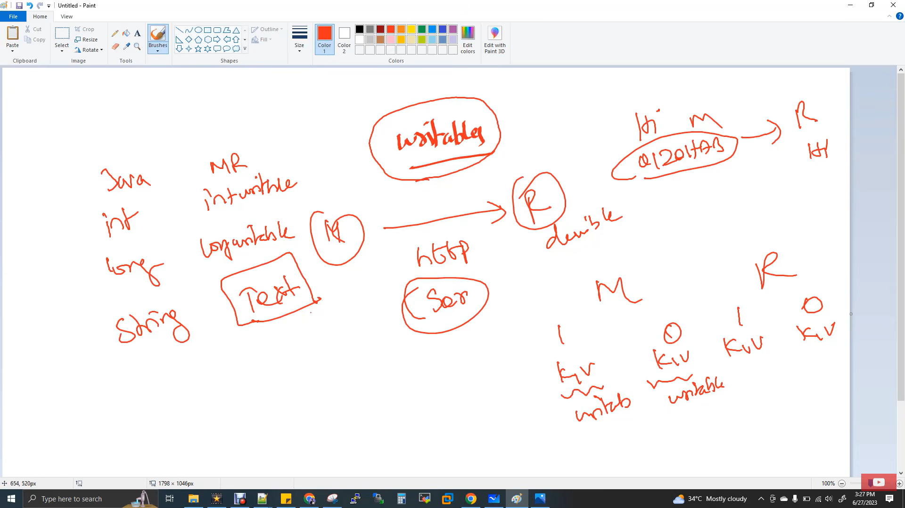
</div>

### 8.1 What are Writables?

I said data goes from map to reducer via **HTTP**. During this transfer, our data gets **serialized**.

**What does serialized mean?**

- Our data is not in actual data format but in a **serialized format**.
- It is a kind of encryption, but not actual encryption.
- It runs in a serialized format.
- Why do they do this? **To transfer data fast via HTTP.**

**This serializer goes from the map side to the reducer side and automatically gets deserialized.**

> **Example:**
> - "hi" is the message.
> - It gets serialized from the map side to `Q120HAB`.
> - When it goes from map to reducer, `Q120HAB` gets deserialized to "hi".

> **Note:** You don't need to do serializer and deserializer. It happens **automatically internally**. That is **Writables**.

### 8.2 MapReduce Data Types

How does MapReduce do this? Our data types.

| Java | MapReduce |
|------|-----------|
| `int` | `IntWritable` |
| `long` | `LongWritable` |
| `String` | `Text` |

> **You must assign the values according to the datatypes.**
>
> When you assign to writable datatypes, serializer and deserializer happen automatically.

### 8.3 When to Use Writable Data Types?

So wherever you use **key-value pairs** for map and reducer input and output, you **must use these writable datatypes**.

> **Question:** "Is MapReduce fully in writable datatypes?"
>
> **Answer:** No, we use normal datatypes (`int`, `long`) in the middle.
>
> **But where do we use them?**
>
> Wherever we **don't denote them as key-value pairs**, we can use normal Java datatypes.
>
> Wherever we use **key-value pairs**, we must use **writable datatypes**.

> **Important:** For the `String` datatype, in writable datatypes, we call it **Text**. Don't think it is not a writable datatype because the word "writable" is not there. **Text is a writable datatype.** It is a naming convention problem. That is why they did it like this.

### 8.4 Data Types for Our Key-Value Pairs

| Key/Value | Data Type |
|-----------|-----------|
| **k1** | `LongWritable` (because we don't know the range of the offset value) |
| **v1** | `String` |
| **k2** | `Text` |
| **v2** | `IntWritable` |
| **k3** | `Text` |
| **v3** | `IntWritable` |
| **k4** | `Text` |
| **v4** | `IntWritable` |

> **Question:** "A list comes inside. Why are you using only IntWritable?"
>
> **Answer:** MapReduce takes care of it. We don't need to put `list of [] IntWritable`.

---

## 9. MapReduce Project Setup in IDE

**Note:** 
- I will show you how to develop this code and build it — everything on **Windows**.
- Finally, we will move it to a **Linux server** to run. In offices, they give **Windows laptops**. 
- Eclipse, Python, Java, and all Big Data / advanced technology development happens on **Windows laptops**. 
- After development, we build the code and move it to the **server** to run. 
- Testing happens on the **server** — all servers are **Linux**.
- Office laptops are **Windows** — development happens there. That is why I am showing it the same way.
 
<div align="center">
  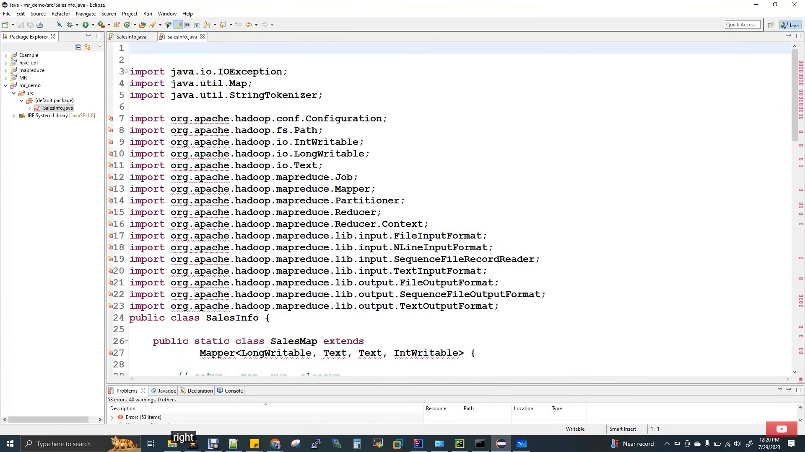
</div>

### 9.1 Why Errors Appear in Eclipse (Hadoop Java APIs)

The code shows **many errors** in Eclipse because:

- Eclipse understands **Java code**, but this is **Hadoop's Java code** (Hadoop Java API).
- The **first 3 imports** are normal Java imports — Eclipse's Java path is already set, so **no error** appears for those, even if there is a Java error.
- The **next imports** will all show errors because they are **Hadoop Java APIs** — these are **not general APIs**, so errors appear.

To remove these errors, we must give **Hadoop's libraries** to Eclipse.

So we are creating a **`lib` directory** and putting all Hadoop **JAR files / library files** there.

<div align="center">
  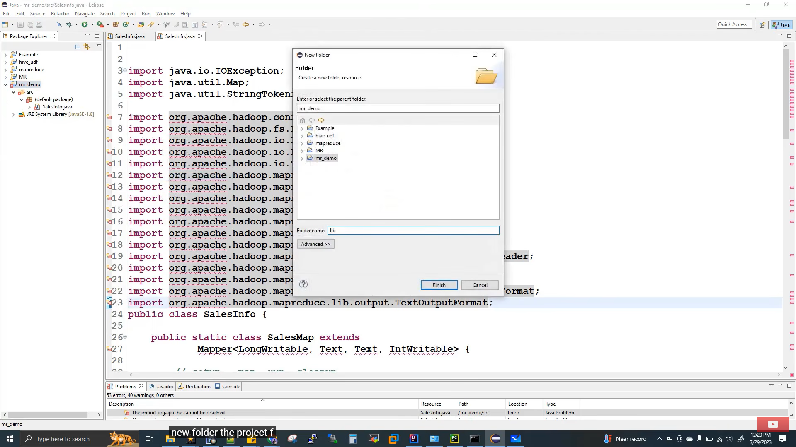
</div>

<div align="center">
  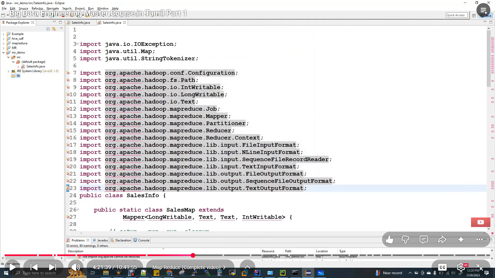
</div>

### 9.2 Real-Time Approach (Maven / SBT(Simple Build Tool))

In real-time, people use **build tools** like **Maven** and **SBT**:

- With build tools, we **don't need to do this manually**.
- In Maven, we just specify **which Hadoop version we need**, and it will **automatically download all the JARs at runtime**.

---
 
### 9.3 What Libraries Do We Need?

- You must have **untarred the Hadoop tar file**.
- The libraries we need are inside the **Hadoop installation directories**.
- If you are writing this program, you **must have installed Hadoop** already.

<div align="center">
  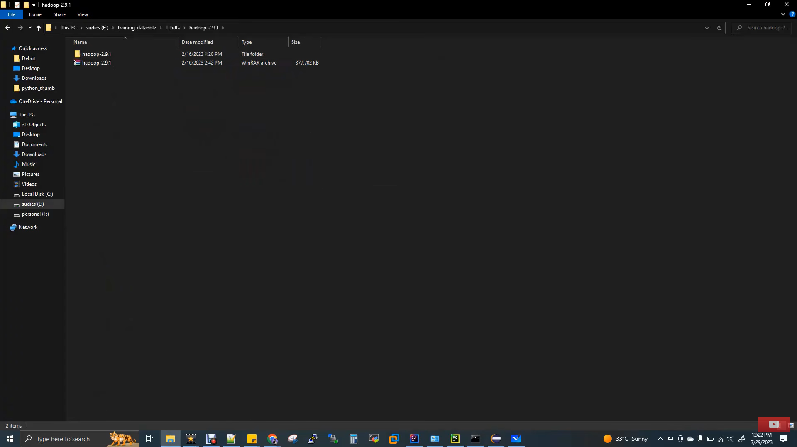
</div>

<div align="center">
  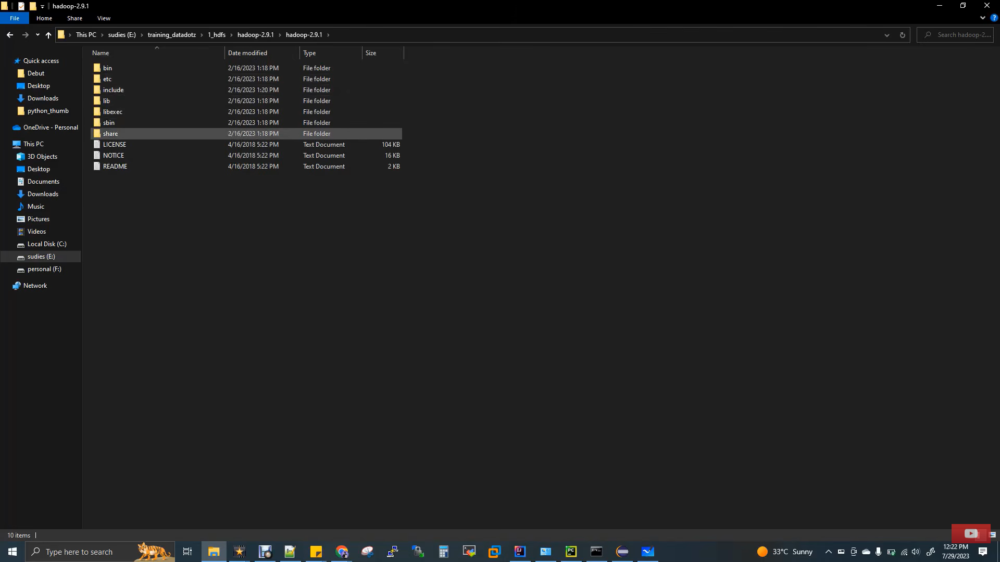
</div>

---
### 9.4 Directories

```
Hadoop tar version directories -> share -> hadoop -> many folders
```

- Inside every folder, there will be **tar files**.
- Copy all of them and put them into the **Eclipse directory**.
- **Very important:** When copying files, there will not only be tar files — there will also be **text files and zip files**.
- **Ignore those** and copy only the required ones.
- If you add everything together, it **will not definitely work**. **Note this down.**

<div align="center">
  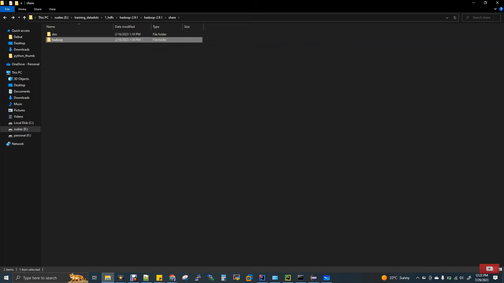
</div>

<div align="center">
  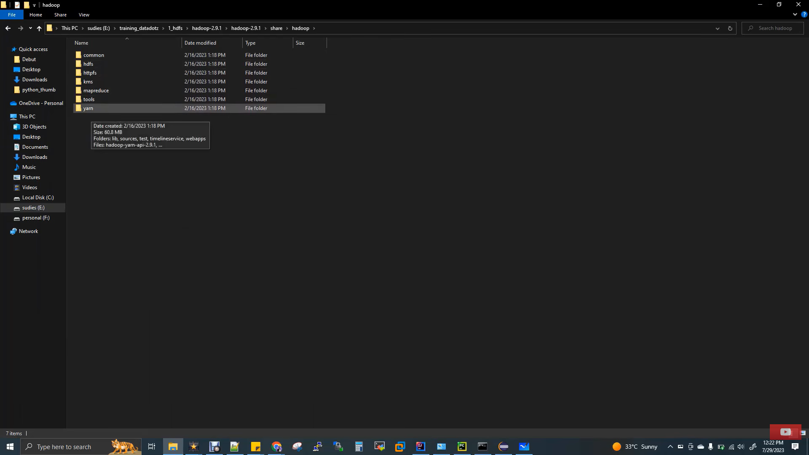
</div>

---

### 9.5 Still Getting Errors?

The files in `lib` are copied from Hadoop directories. After that, if you **still get errors**, Eclipse is telling you:

> "Use the libraries in the directories — build a path for them."

<div align="center">
  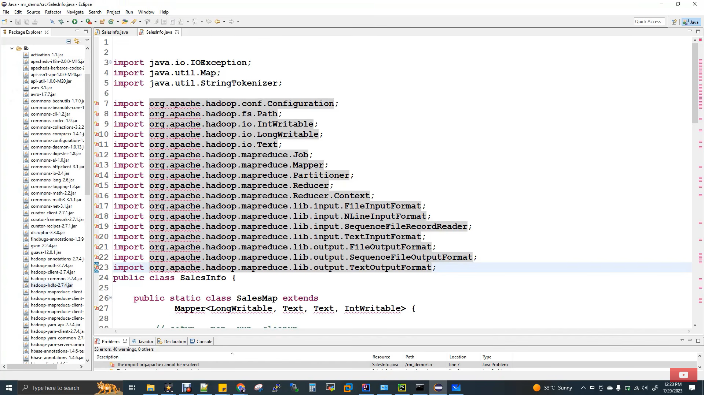
</div>

<div align="center">
  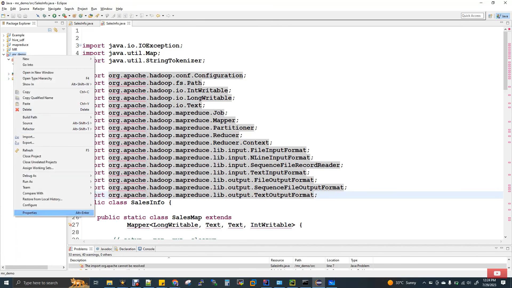
</div>

<div align="center">
  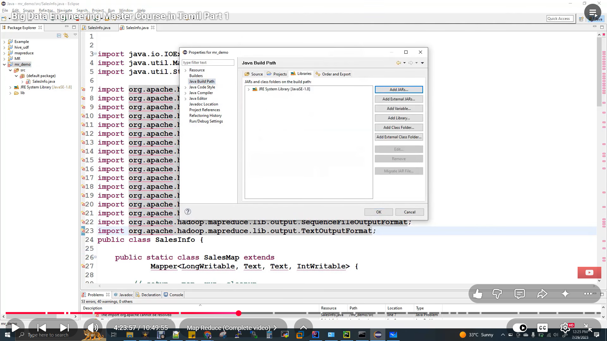
</div>

<div align="center">
  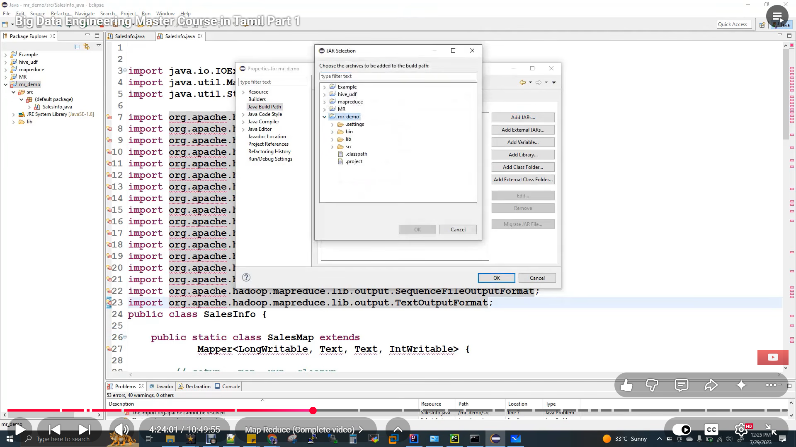
</div>

<div align="center">
  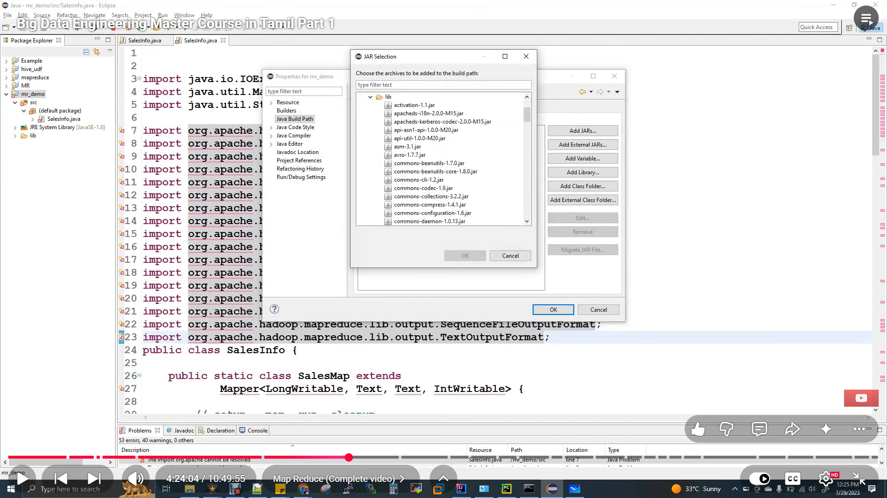
</div>

<div align="center">
  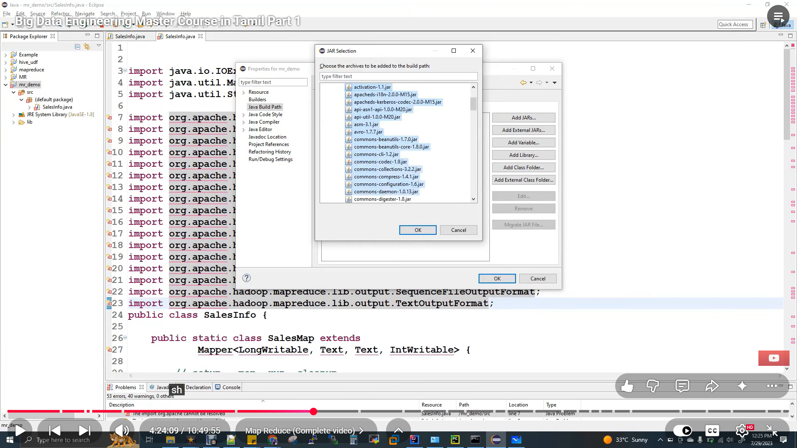
</div>

<div align="center">
  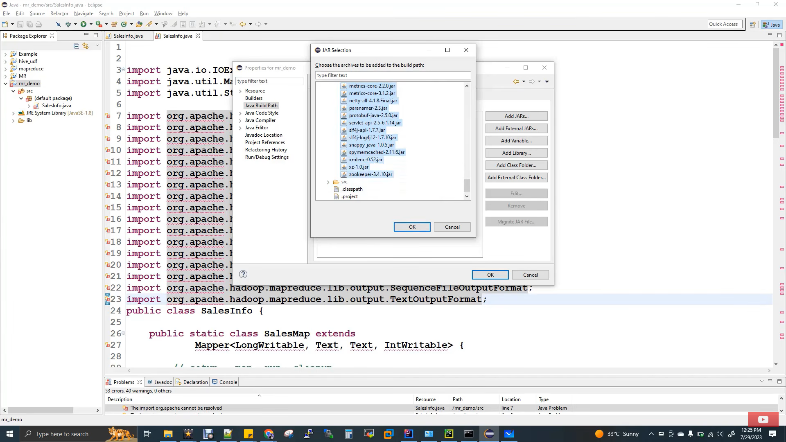
</div>

<div align="center">
  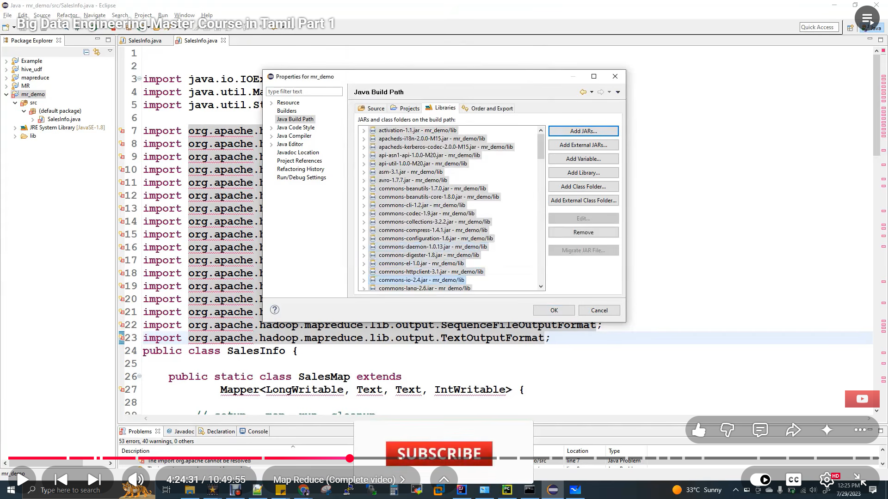
</div>

<div align="center">
  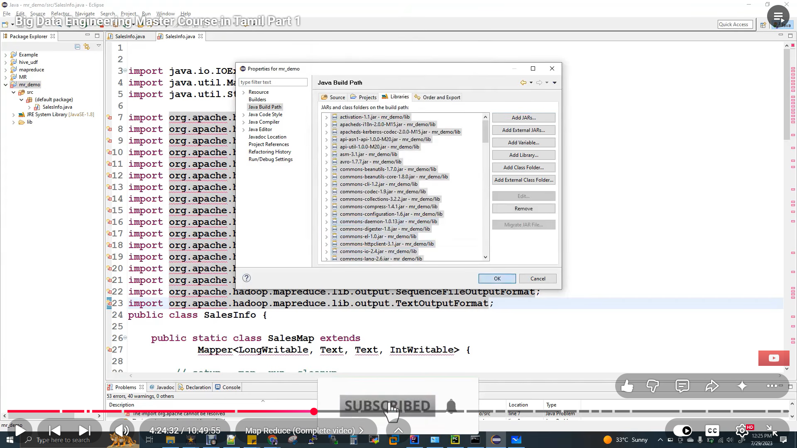
</div>

<div align="center">
  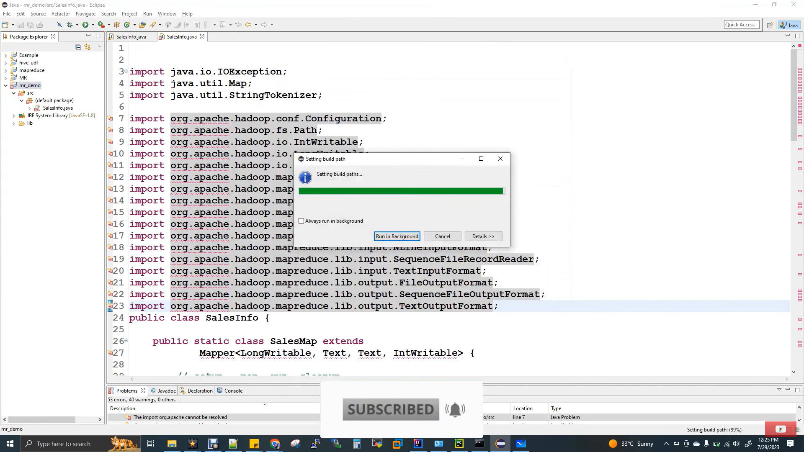
</div>

<div align="center">
  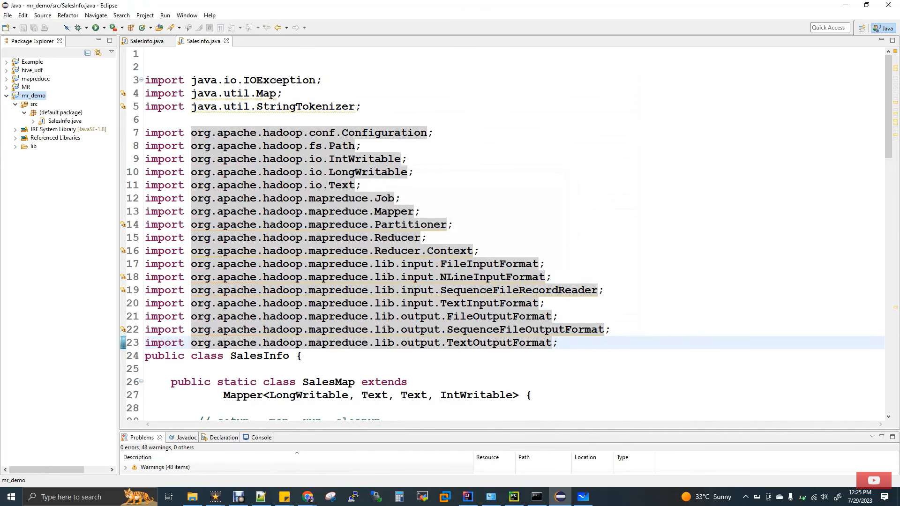
</div>

## 10. MapReduce Code Walkthrough

<div align="center">
  
</div>

<div align="center">
  
</div>

<div align="center">
  
</div>

### 10.1 Setting Up Libraries in Eclipse (lib Directory)

The `setup`, `map`, and `cleanup` methods are all inside the **Mapper class**.

But we write code only in the **`map` method**. So why do we need `setup`? Let me give an example.

### 10.2 Example: JDBC MapReduce

Suppose you want to write a **JDBC MapReduce** — meaning you want to connect to a **MySQL database**, read the files/tables inside it, and process them.

- You start writing MapReduce, so you **only use the `map` method**.
- The logic you write inside `map` runs for **every single record**.

### 10.3 How Many Times Does the Map Method Run?

> It depends on your **input records**.

For example, if we have **6 records**, then the logic inside `map` will run **6 times**.

### 10.4 The Problem with JDBC Connections

Imagine you write a **JDBC connection** inside the `map` method:

- That table has **10 records**.
- Then the connection will be created **10 times**.
- That means **one record = one connection**.

**This is extremely dangerous in real-time.** Data engineers read **1 million to 2 million records** with **one connection**.

- If 10 records create 10 connections, you are putting **too much weight on MySQL**.
- The database becomes slow, and your job becomes slow.
- **The more connections you create, the more you pay.**

### 10.5 The Solution: `setup()` Method

So what do we do?

- `map` runs for **every record**.
- That is why we use the **`setup` method**.

#### `setup` Method

> **One mapper = one `setup` call (one time only).**

- If 10 maps are running, each mapper can receive **1 million records**.
- 10 mappers → 10 million records can be read.
- But **per mapper, `setup` runs only once**.
- So for 10 mappers, `setup` runs **10 times**.

**Any one-time invocation logic should be written in the `setup` method.** That is the functionality of the `setup` method.

#### `cleanup` Method

> The function you created (like a connection) needs to be **closed** — that is done in `cleanup`.

- `setup` starts **before `map`** — runs **once per map**.
- `cleanup` runs **after `map` finishes** — runs **once per map**.

#### `run` Method

> The **driver program** related information — meaning our **job's information** — we normally give there.

- Instead of that, we give it in the **`main` method**.
- So **`run` is not needed for us**.

---

### 10.6 Mapper Class — setup(), map(), cleanup(), run()

The **Mapper class** contains:

| Method | Purpose |
|--------|---------|
| `setup()` | One-time initialization per mapper |
| `map()` | Runs for every record |
| `cleanup()` | Close resources after map finishes |
| `run()` | Driver/job information (not needed — use `main`) |

---

<div align="center">
  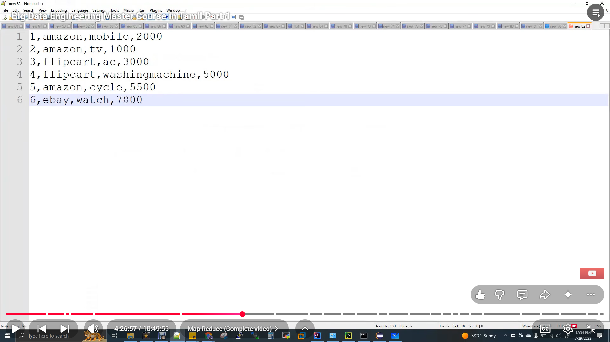
</div>

<div align="center">
  
</div>

### 10.7 Reducer Class — Same 4 Methods

The **Reducer class** also has the **same 4 methods**:

- `setup()`
- `reduce()` (equivalent to map)
- `cleanup()`
- `run()`

> The **same definitions apply** to the Reducer class as well.

<div align="center">
  
</div>

<div align="center">
  
</div>

<div align="center">
  
</div>

<div align="center">
  
</div>

### 10.8 Important Notes (context.write & Iterable)

### Note 1: `context` and `context.write()`

- For **both Mapper and Reducer**:
  - The **final map/reducer output** is stored in the **local file system**.
  - That is what `context.write()` does — it writes **key-value pairs**.
  - It acts like an **output collector**.

### Note 2: `Iterable`

For example, consider this list:

```
[2000, 1000, 3000]
```

- Iterable will iterate: **2000, 1000, 3000**.
- You **don't need to iterate record by record** — MapReduce will do it for you.
- We **don't need to do it manually**.
- This data type is made **generic as Iterable** so that we can **iterate the values inside the list**.

---

## 11. MapReduce JAR File Creation

<div align="center">
  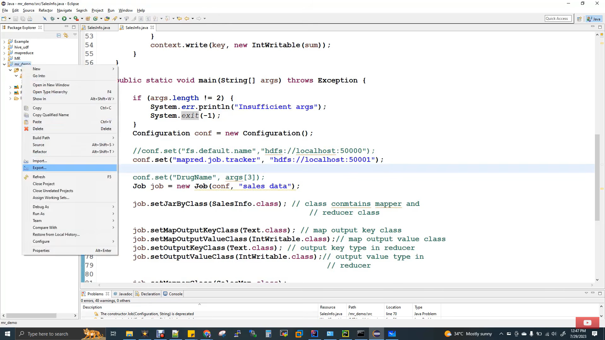
</div>

<div align="center">
  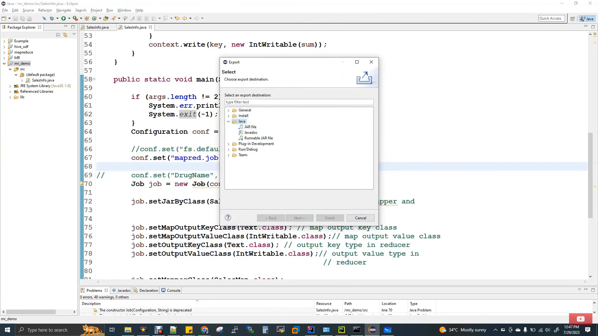
</div>

<div align="center">
  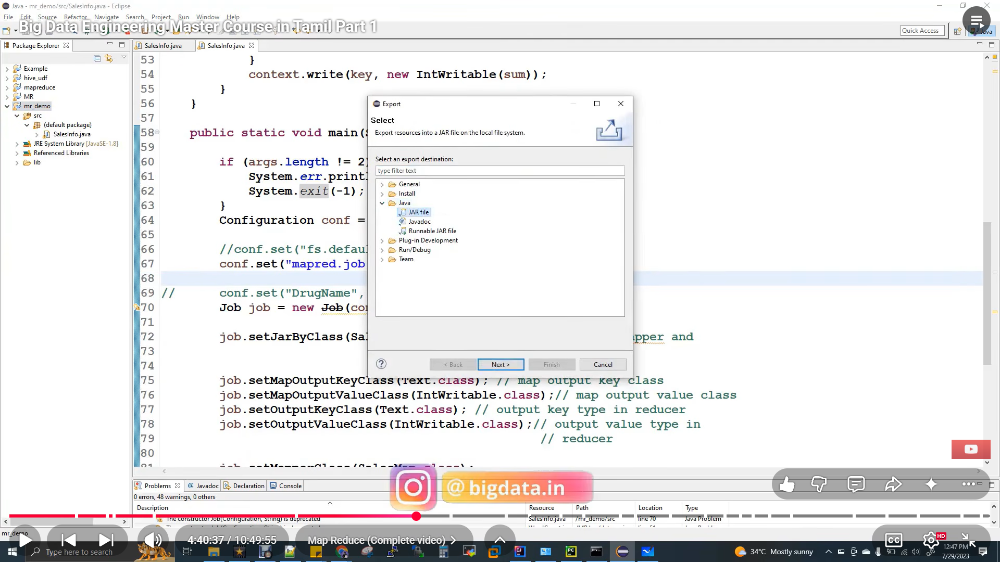
</div>

<div align="center">
  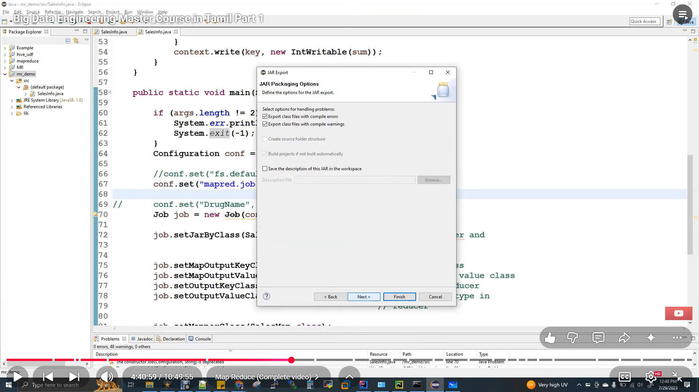
</div>

<div align="center">
  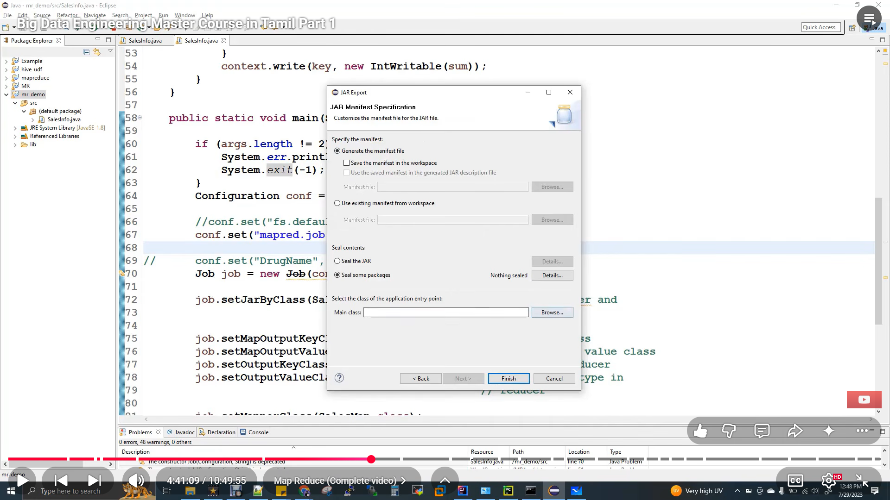
</div>

<div align="center">
  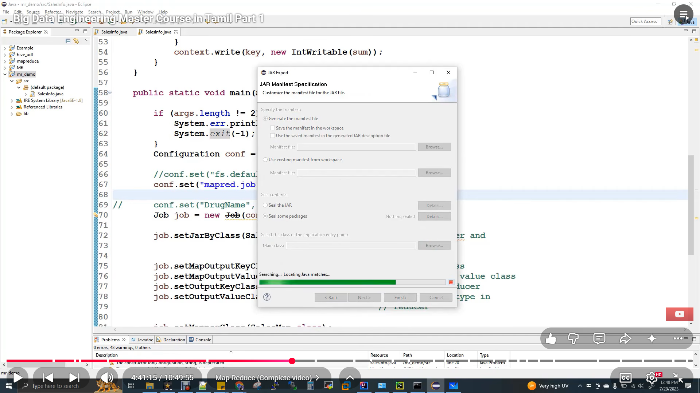
</div>

<div align="center">
  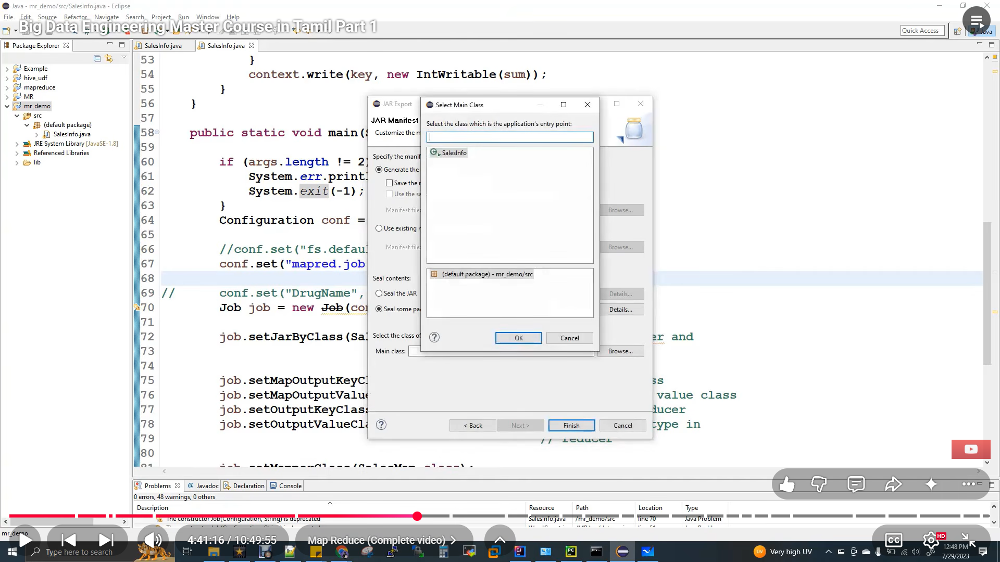
</div>

<div align="center">
  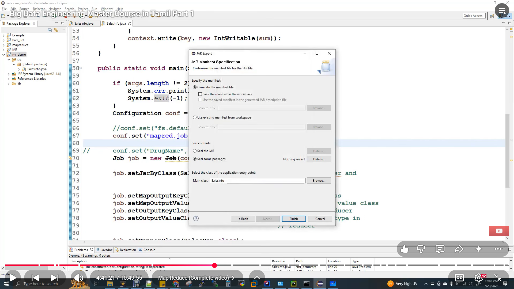
</div>

<div align="center">
  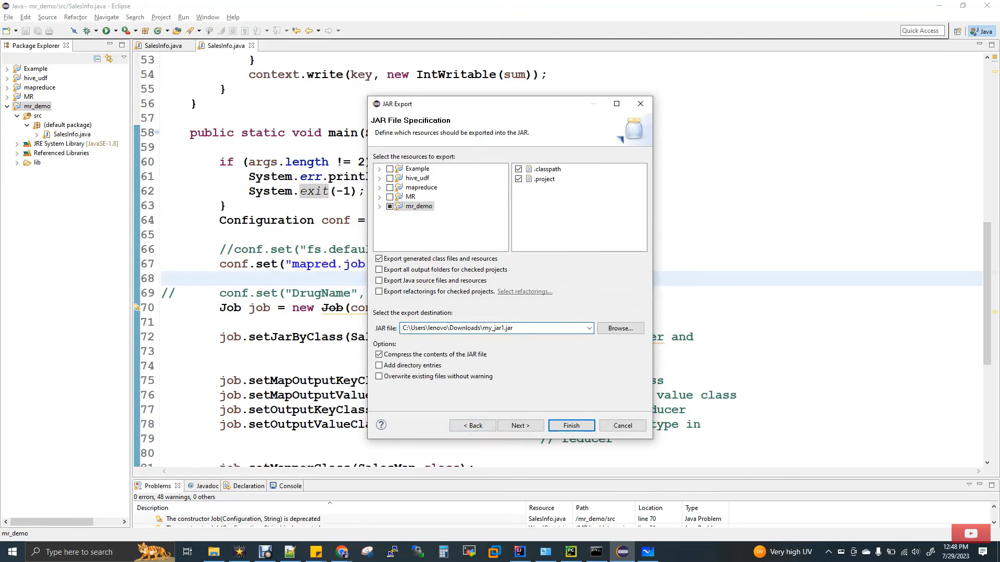
</div>

<div align="center">
  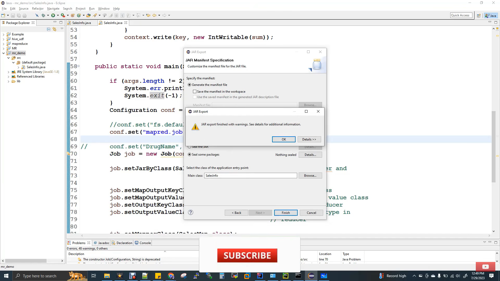
</div>

<div align="center">
  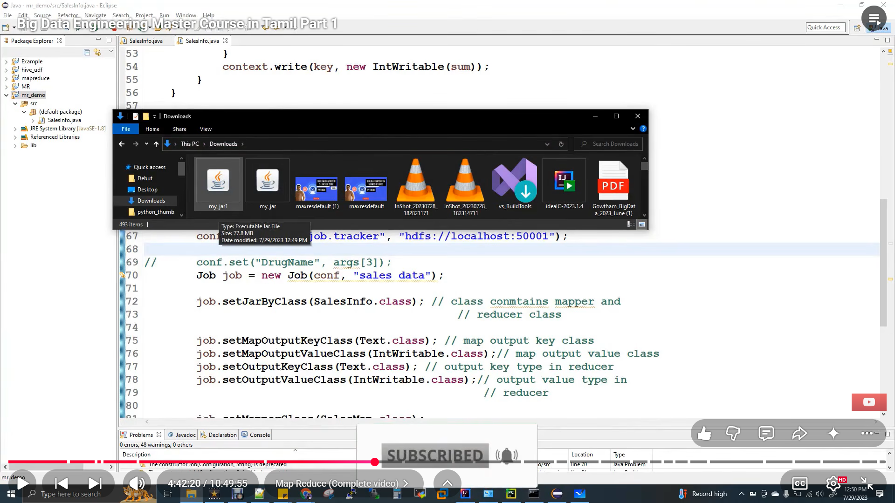
</div>

- This is how we **build the JAR file**.
- This **JAR file** is what we will **move to the Linux server and run**.

<div align="center">
  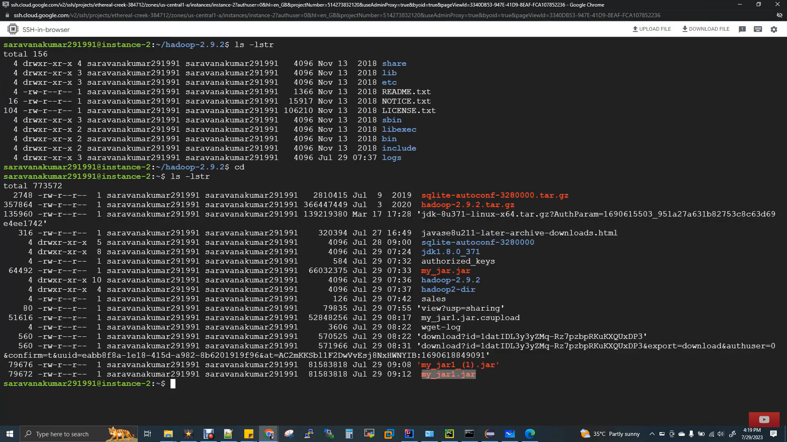
</div>

> The JAR file is at the **end of the Home directory**.

---

### 11.1 Starting Hadoop on Linux Server

<div align="center">
  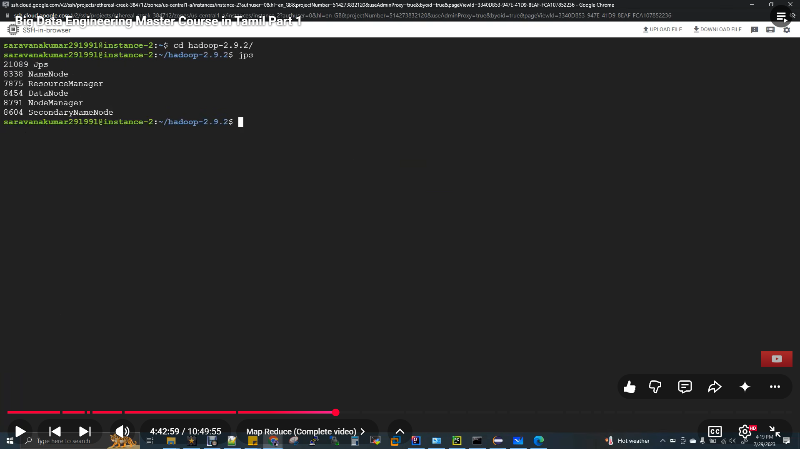
</div>

After changing the Hadoop folder and going inside the Hadoop directories, then changing directories again:

```bash
cd sbin
```

Then run the command to **start all Hadoop services**:

```bash
./start-all.sh
```

Then again change directories to Hadoop directories to check whether Hadoop is working:

```bash
jps
```

- `jps` = **Java Process Status**
- All **5 daemons** should be running.
- So you must **start Hadoop first**, and the **JAR file must be ready**.

<div align="center">
  
</div>

### 11.2 Creating and Uploading Input File to HDFS

Now, prepare the **input file** first locally.

Change directory and give the input command:

```bash
vi sales.txt
```

- `vi` = **Visual Editor** in Linux, used to create and edit files.

<div align="center">
  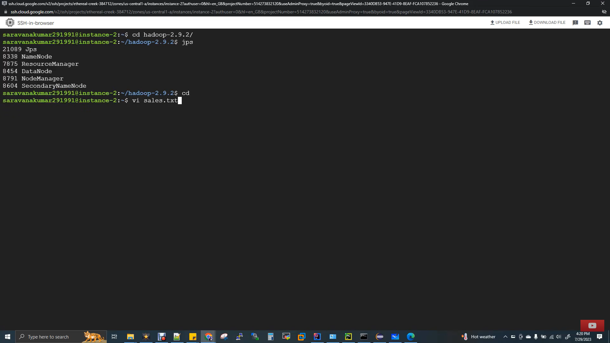
</div>

Then:

- Copy the data from Notepad.
- Paste it into the sale.txt vi file.
- **Don't Add a newline at the end.**
- Save it.

<div align="center">
  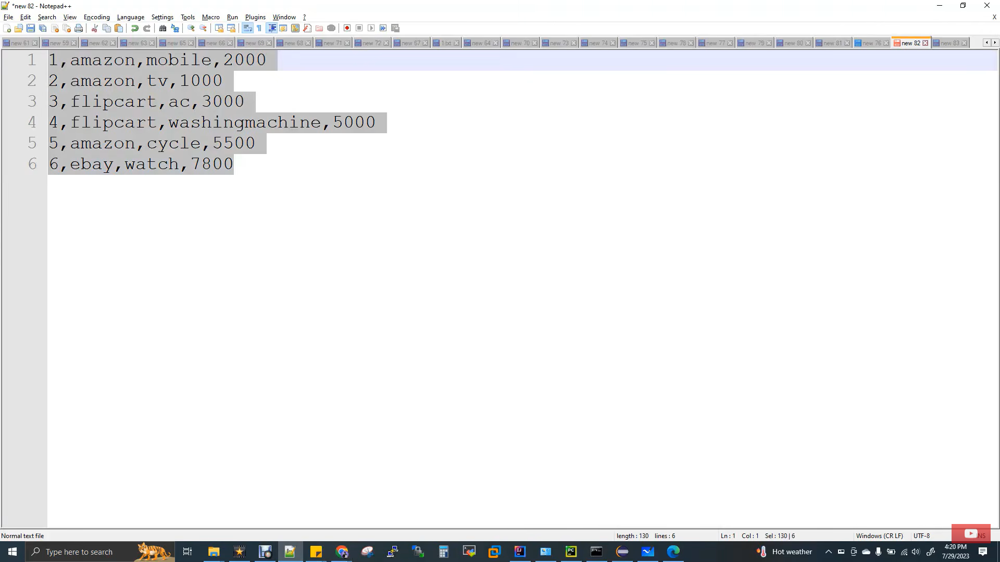
</div>

<div align="center">
  
</div>

Now, this file must be **put into Hadoop**.

Change to Hadoop directories and run:

```bash
bin/hadoop dfs -put ~/sales.txt /sales.txt
```

> The HDFS file can have the **same name or a different name**.

- `~/` = `/home/username/filename` (home path).
- So now we are **uploading `sales.txt` from local Linux to HDFS**, because this file is the **input for our MapReduce code**.

### Command Breakdown

| Part | Meaning |
|------|---------|
| `bin/hadoop dfs` | `dfs` = **Distributed File System** |
| `-put` | **Upload/Copy** — take a file from local machine and copy it into HDFS |
| `~/sales.txt` | **Source file** — `~` means your home directory. "Take `sales.txt` from my home directory" |
| `/sales.txt` | **Destination path inside HDFS** — "Put the file in the main root directory of HDFS and name it `sales.txt`" |

> **Note:** The `/` at the beginning represents the **root of HDFS**, not your local Linux computer.

<div align="center">
  
</div>

---

### 11.3 Running the MapReduce JAR

Now, run the JAR file. Here we use `~/` which equals `/home/username/filename` (home path).

- Give the **input file** that we already uploaded to HDFS.
- Then `/mr_output` — our output directory — a file will be stored inside it.
- `/mr_output` means it is a **directory**.

### What is `/mr_output`?

> It is the name of the **output folder** where Hadoop will save the **final result** of your MapReduce program.

- `mr` = **MapReduce**
- `output` = **the result**
- The `/` at the beginning means it is located in the **root directory of HDFS** (not your local Linux computer).

<div align="center">
  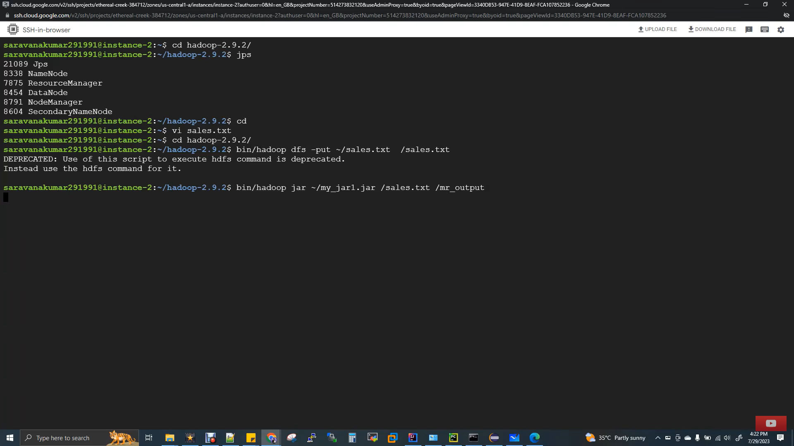
</div>

### Job Execution

Now your MapReduce job starts:

- **MR job starts** and an **MR ID is generated**.
- **Map 0% → 100%**, then **Reduce 0% → 100%**.
- This is a **very small file** — one block size in Hadoop 2 is **128 MB**.
- This is less than that, so **1 block = 1 map**.
- Similarly, we said in the code that **only 1 reducer** is needed.
- So the map ran from **0% to 100%** quickly.
- Similarly, the reducer ran from **0% to 100%** quickly.
- Now the **job is complete**.

<div align="center">
  
</div>

###  Understanding the Output (part-r-00000)

Now let's look at the output. I already told you the output will be stored in **HDFS**.

```bash
bin/hadoop dfs -ls /
```

- This displays **all directories and files in HDFS**.
- Among them, our given directories will appear.
- When you run the command, a file called **SUCCESS** and a file called **`part-r-00000`** will be created.
- **`part-r-00000`** is where our **output** is.

To display the content:

```bash
bin/hadoop dfs -cat /mr_output/part-r-00000
```

### Decoding `part-r-00000`

> This is the **actual result file** produced by your MapReduce job.

| Part | Meaning |
|------|---------|
| `part` | A **"part"** of the output. Hadoop splits output into multiple files. |
| `r` | Stands for **Reducer**. This file was created by a Reducer. (If it was `m`, it would mean **Mapper output**.) |
| `00000` | The **file number**. Since you have only 1 reducer, there is only 1 file, numbered `00000`. If you had 2 reducers, you would see `part-r-00000` and `part-r-00001`. |

> Now the final output is in **HDFS** — it is **not local**. So I used the HDFS command to **display it to you**.

<div align="center">
  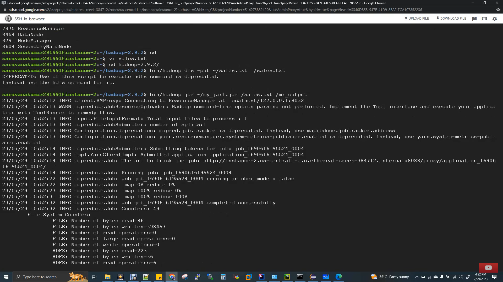
</div>

<div align="center">
  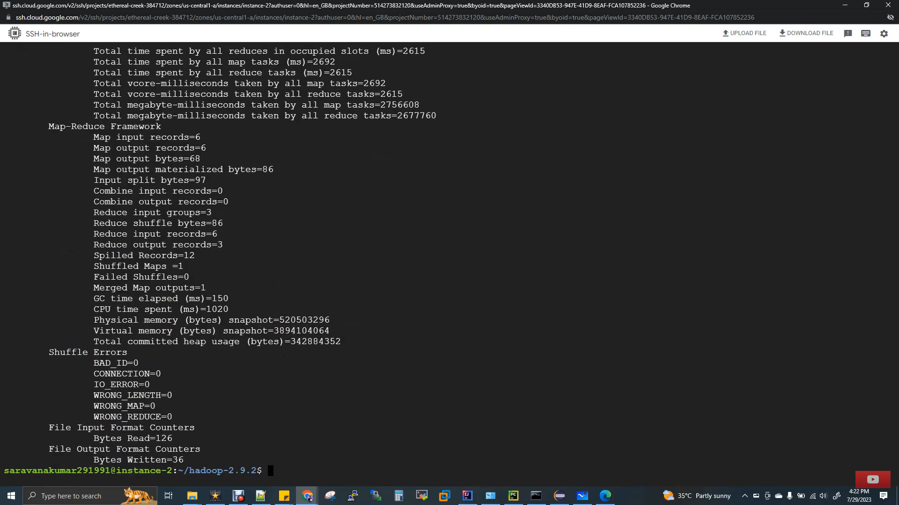
</div>

<div align="center">
  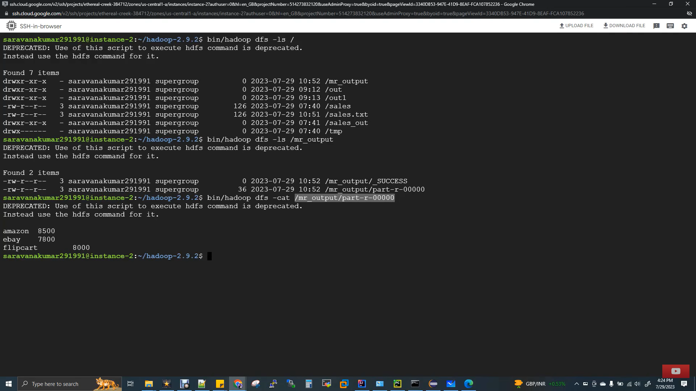
</div>

---

## 12. MapReduce YARN Architecture 

**Note**: Yet Another Resource Negotiator (YARN)

<div align="center">
  
</div>

### Hadoop 1

- **YARN did not exist** in Hadoop 1.
- YARN was introduced in **Hadoop 2**.
- It is a kind of **cluster manager**.

**Hadoop 1 stack:**

```
HDFS
  └── MapReduce
        └── Hive, Pig, Sqoop, Oozie
```

### Hadoop Version 2

**Hadoop 2 stack:**

```
HDFS
  └── YARN (new layer built on top)
        └── MapReduce
              └── Hive, Pig, Sqoop, Oozie
```

- They built a **new layer called YARN** on top of HDFS.
- YARN has its **own separate execution model**.
- On top of YARN, **MapReduce** sits.
- But it's not only MapReduce — **Spark** and **Storm** can also be deployed on top of YARN.
- So many technologies similar to MapReduce run on YARN.
- YARN created a **common execution model**.
- So whether it's MapReduce, Spark, or Storm — they all use the **same execution model**.
- The underlying core performance differs — Spark runs Spark's own way, MapReduce runs its own way — but the **execution model is YARN**.

### Why Was YARN Introduced?

They found **problems in MapReduce**, so they decided a **common execution model** was needed — one that would work for **Spark, Storm, and many other technologies**.

### The Problem in Hadoop 1 (Job Tracker & Task Tracker)

- There is a **Job Tracker (JT)** and **Task Trackers (TT)**.
- The Job Tracker **assigns jobs** to Task Trackers.
- If a task **fails**, the Job Tracker must check.
- If a task **succeeds**, the Job Tracker must check.

**Example:**

- **Gowtham** submits a job.
- **Kumar** submits a job.
- The **Job Tracker** monitors both jobs, assigns tasks, starts reducers after maps finish — for **both jobs separately**.
- Now a **Hive request** comes — that also goes through the Job Tracker, because Hive also runs on MapReduce.
- So the **Job Tracker gets resource pressure** — performance slows down.

### Real-Time Example: CEO & Supervisors

Imagine you are a company owner with **20,000 employees** — a large corporation.

- If all 20,000 employees report **directly to you**, how would it be?
- That's why companies have a **CEO**, and below the CEO are **supervisors**, and below each supervisor are **10 employees**.

So:

- **3 supervisors**, each with **10 employees** = 30 employees total.
- They **don't report directly to the CEO**.
- Each of the 10 employees reports to their **supervisor**.
- The **3 supervisors** report to the **CEO**.

**Difference:** 30 people reporting vs. 3 people reporting.

- The **CEO's resource pressure is lower**.
- The **CEO's performance is higher**.

> **That is exactly what YARN does.**

### Master-Slave Architecture Across Technologies

| Technology | Master | Slave |
|------------|--------|-------|
| MapReduce | Job Tracker | Task Tracker |
| Spark | Master | Worker |
| Storm | Nimbus | Supervisor |

- All of them have a **master-slave architecture**.
- All of them face the **same problem** — direct resource pressure increases.
- **YARN helps all of them** by providing a **CEO-supervisor model**.

### Hadoop 2 Daemons

In Hadoop 2, the daemon names changed:

- **Resource Manager** (Master)
- **Node Manager** (Slave)

> These 2 daemons are **not only for MapReduce** — they also run for **Spark** when Spark is deployed on YARN.

### Is YARN Necessary for Spark?

- **No, it is not compulsory.**
- For Hadoop, **MapReduce must run on YARN**.
- But Spark has its **own execution architecture**.
- Spark can run **without YARN**.
- Similarly, **Storm can also run without YARN**.
- But in **real-time Big Data projects**, Spark is **mostly run on YARN**.

<div align="center">
  
</div>


### Resource Manager Components

The Resource Manager runs on one machine, and it has **2 components**:

1. **ASM (Application Manager)**
2. **Scheduler**

Both communicate with each other.

### How YARN Works — Step by Step

1. A user sends a request using **MapReduce + YARN**.
   - Submitting the same MapReduce code to the Resource Manager is called **YARN** — nothing else.
2. The request first goes to the **Application Manager**.
   - Think of ASM as the **CEO**.
   - The Resource Manager runs on a **master node**.
   - ASM and Scheduler communicate and decide **how much capacity** this particular user's (Gowtham's) job needs.
3. Now we need **slave nodes** — let's say **3 slave nodes**.
   - **Node Manager** daemon runs on them.
   - Just like Version 1 had **Job Tracker (Master)** and **Task Tracker (Slave)**, Version 2 has **Resource Manager (Master)** and **Node Manager (Slave)**.
4. Suppose the job's input initially has **no blocks** — actually **b0 has one block** and **b1 has one block**.
5. ASM does this:
   - As soon as the request comes, ASM goes to some slave node and **launches an AM (Application Master)**.
   - This **AM is the supervisor**.
6. ASM says:
   > "I cannot handle where the blocks are, how many map tasks to launch, how many reduce tasks to launch — so instead, I will **hire a supervisor**."
7. The **Application Master (AM)** becomes the **supervisor** — ASM is the **CEO**.
8. This supervisor is like the **Job Tracker** in MapReduce Version 1.
9. The AM launches **map tasks** on:
   - **b0 → Slave 2**
   - **b1 → Slave 3**
10. When these 2 tasks finish, **heartbeats** go to the **AM (Application Master)**.
11. Suppose **Slave 2 fails** suddenly.
    - The AM checks where the **b0 copy** is available.
    - This is exactly what the **Job Tracker** also does.
    - Suppose the **b0 copy is on Slave 7**.
    - So the AM **relaunches the failed task on Slave 7**.
    - This is the **Job Tracker architecture**.
12. Now another user **Kumar** submits a MapReduce job.
    - ASM again goes to some slave node and **launches another AM**.
    - This AM works for **Kumar's job**.
13. These **2 AMs do not interfere** with each other.
    - **Each AM is like a Job Tracker for one job.**
14. The **main Job Tracker is ASM**.
    - The AM does all the Job Tracker work.
    - **ASM only monitors the AM.**
15. Suppose the **AM itself crashes**.
    - Immediately a **report/acknowledgement goes to ASM** — whether the AM succeeded or failed.
16. If the AM **failed**:
    - ASM **launches another AM**.
    - That new AM **relaunches all the tasks**.
17. This is the **CEO-supervisor concept** that YARN brought in.
    - This is the **YARN execution model architecture**.
    - Because it works well, **Spark and Storm run on top of YARN**.

---

## 13. Input Split

<div align="center">
  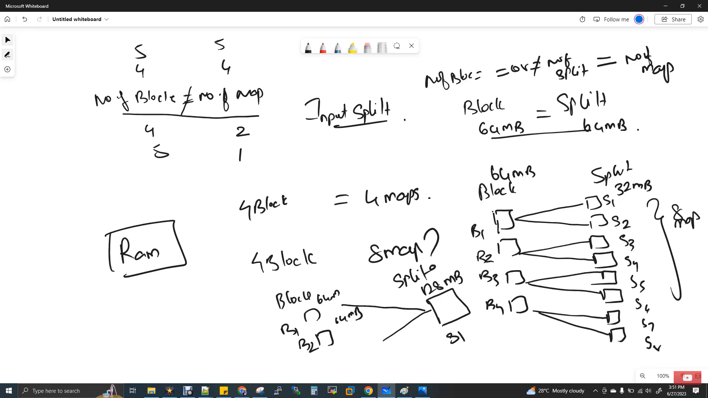
</div>

### Relationship Between Blocks and Mappers

- **Number of blocks = Number of mappers** — not always.
- 4 blocks → 4 mappers.
- 5 blocks → 5 mappers.

> **But:** Number of blocks is **not always equal** to number of mappers.
> - 4 blocks → 2 mappers possible.
> - 5 blocks → 1 mapper possible.

**How is this achieved?** Through **Input Split**.

### Input Split Configuration

- Input Split is a **configuration** in **`mapred-site.xml`**.
- By default:
  - If your **block size is 64 MB**, then the **split size is also 64 MB**.

### Example: Increasing Mappers

- You want to run **4 mappers** → by default, 4 mappers will be taken.
- Now the admin says:
  > "There is a lot of free RAM — use it and create more parallelism."
- So can we run **8 mappers for 4 blocks**?
  - **Yes.**
  - By default: **block size = split size**.
  - Suppose block size = 64 MB, and 4 blocks are at 64 MB.
  - This split is called **logical** — it is **not physical**.
  - It is **completely logical**.

### Changing Split Size

- Can we change the split size from **64 MB to 32 MB**?
  - **Yes** — one configuration in our MapReduce code.
- The **physical 64 MB block** becomes:
  - **64 MB = 32 MB + 32 MB (two logical splits)**
- So now:
  - **4 blocks = 8 splits = 8 mappers**

### The Actual Formula

```
No. of blocks = or ≠ No. of splits = No. of maps
```

- A block can be:
  - **equal to** split (64 MB = 64 MB)
  - **or not equal to** split (64 MB = 32 MB)

> This configuration will be shown when explaining the code.

**Important:**
> However many splits there are, that many mappers will be created — **this is always equal**.

### Purpose of Input Split

Using Input Split:
- We can create **more mappers** than blocks.
- Or create **fewer mappers** than blocks.

### Example: Fewer Splits (Low RAM)

- Suppose RAM is low.
- You have **2 blocks of 64 MB** (b1, b2).
- You want to create **only one split**.
- So you set the split size to **128 MB**.
- Then the 2 × 64 MB blocks **logically become one 128 MB split**.
- Whatever splits there are, that many mappers — so **1 split = 1 mapper**.
- **When RAM is low, we try to reduce parallelism.**
- **When RAM is high, we try to increase parallelism.**

---

## 14. Speculative Execution

This is a **common terminology** — not only in MapReduce.

<div align="center">
  
</div>


### Scenario

- The Job Tracker has launched **2 tasks**:
  - **Task Tracker 1 → b0**
  - **Task Tracker 2 → b1**
- We have **copies of both blocks on other nodes** too.
- So **2 copies of b0 and b1** exist.
- But only **one copy** runs on the Task Tracker.

### Execution Progress

- Both are running.
- **Both reach 70% completion.**
- Then the **2nd Task Tracker reaches 99%**.
- But the **1st Task Tracker is stuck at 80%**.
- The 1st map execution is **stuck** — it has not failed, just stopped.

### What Happens Next?

- The 2nd Task Tracker goes from **99% → 100%**.
- But the result only comes when **all map tasks finish** — the reducer completes only then.
- So the Job Tracker senses:
  > "This one is stuck. It is getting late."
- This is called a **speculative problem** — the Job Tracker identifies it.

### Speculative Execution

- The Job Tracker sees that **another copy of b0 exists on another node**.
- So it **tells that node's Task Tracker to run the same execution**.
- This duplicate task runs at:
  - **10% → 20% → 30% → 70% → ...**

### Duplicate Task

- **Yes, a duplicate task runs.**
- The 1st Task Tracker is still running — but stuck, not failed.
- So the Job Tracker **does not kill it**.
- It starts a **3rd Task Tracker** on another node.
- Suppose the **3rd Task Tracker reaches 90%**.
- At that moment, the **stuck 1st Task Tracker jumps to 99% and finishes at 100%**.
- Now the Job Tracker **kills the 3rd Task Tracker** and **considers the 1st Task Tracker's result**.

### If the Stuck One Never Recovers

<div align="center">
  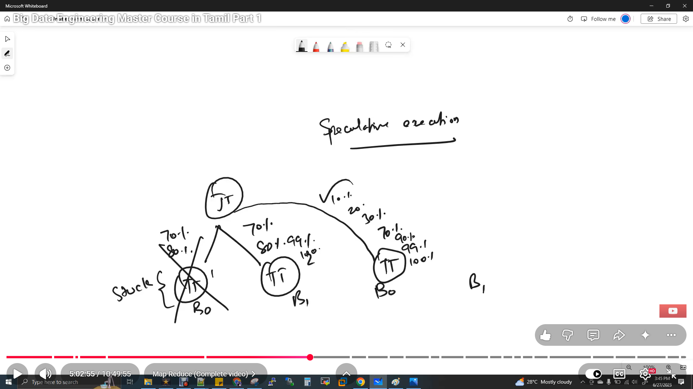
</div>

- If the stuck 1st Task Tracker **never recovers**,
- The newly started **3rd Task Tracker completes 99% → 100%**.
- The Job Tracker **kills the 1st Task Tracker** and **takes the 3rd Task Tracker's completed result**.

> **This is called Speculative Execution.**

### Key Points About Speculative Execution

- Speculative Execution runs a **duplicate task**.
- But **only one output** comes:
  - Either from the **stuck one**, or
  - From the **newly started one**, or
  - If the stuck one suddenly works, from **that one**.
- **But the final output is only one** — the other is killed.

### Multiple Stuck Tasks

- Suppose **10 tasks are stuck**.
- Then **10 speculative executions** will happen.
- Some people say it is an **advantage**.
- Some people say it is a **disadvantage**.
- **It depends on performance.**

> So they decide whether to **enable or disable speculative execution** based on performance.

---

## 15. MapReduce Conclusion

- **MapReduce is that much only** — you don't need to learn anything deeply beyond this.
- In **Spark**, you can spend all your time.
- Plus, **interview questions based on MapReduce** are asked today.
- So **knowing this well is a good thing**.

---

## Quick Reference — Command Cheat Sheet

| Command | Purpose |
|---------|---------|
| `cd sbin` | Change to sbin directory |
| `./start-all.sh` | Start all Hadoop services |
| `jps` | Java Process Status — check daemons |
| `vi sales.txt` | Create/edit file in Linux |
| `bin/hadoop dfs -put ~/sales.txt /sales.txt` | Upload local file to HDFS |
| `bin/hadoop dfs -ls /` | List all HDFS directories/files |
| `bin/hadoop dfs -cat /mr_output/part-r-00000` | Display output file content |

---

## Glossary

| Term | Full Form / Meaning |
|------|---------------------|
| HDFS | Hadoop Distributed File System |
| YARN | Yet Another Resource Negotiator |
| JT | Job Tracker |
| TT | Task Tracker |
| RM | Resource Manager |
| NM | Node Manager |
| AM | Application Master |
| ASM | Application Manager |
| JPS | Java Process Status |
| MR | MapReduce |


